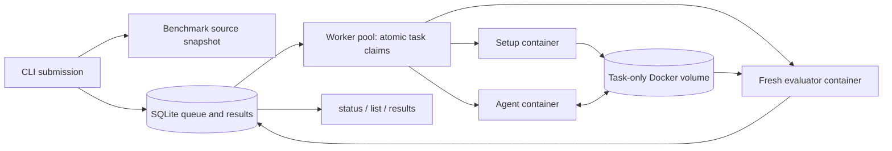

# Agentic Harness

A Python 3.11+ CLI that queues benchmark tasks, runs interchangeable agents in Docker, and stores status and results in SQLite. Both supplied benchmarks are supported without making their CLIs identical.

## What the assignment asks for

1. Normalize benchmark tasks, create their environments, run an agent, grade solutions, and aggregate scores.
2. Submit multiple runs without blocking; background workers pull work from a persistent queue with bounded concurrency.
3. Persist results, expose active runs and completed results, and explain the architecture and setup.
4. Demonstrate mini-swe-agent against Bash Operations and Python Tasks. Additional agents are optional.

The provided CLI was a scaffold. Bash uses `task_id`/`problem_statement`, flag-based setup and grading, and exit 1 for a wrong answer. Python uses `id`/`prompt`, a positional task ID, and exit 0 even when grading fails. Adapters normalize these differences; the worker never branches on a benchmark name.

## Setup

Install [uv](https://docs.astral.sh/uv/getting-started/installation/) and [Docker Desktop](https://docs.docker.com/desktop/), and start Docker. From this source checkout:

```bash
uv sync --frozen
uv run harness doctor
make images
```

`make images` builds a Python evaluator with pytest, a Python agent runtime, and an Alpine agent runtime. The Alpine image includes Python and Bash so mini can run inside it. The dataset's `alpine:latest` maps to the pinned Alpine 3.21 runtime; the Python task image maps to a Python 3.11 runtime. Image tags and full dependency pins are defined in `docker/`. The first build requires internet and may take several minutes. Docker base images use version tags rather than immutable digests; pin digests for fully repeatable infrastructure.

The ZIP omitted the mini-swe-agent Git submodule. This implementation uses the published `mini-swe-agent==1.17.0`, compatible with the starter CLI, inside the agent images. No host agent install or `git submodule` initialization is required. `docker/mini.yaml` comes from upstream tag v1.17.0 (commit `d9dfb18524ab1815fd4733bc60ae71ee0f2456a7`), with limits of 50 steps and approximately $1 per task. Its MIT license is included. The current upstream major version differs; upgrade the wrapper and config together.

Provide a model name and its API key in the **worker's environment**. For example, select your provider/model and enter a key without placing it in shell history:

```bash
export MSWEA_MODEL_NAME='provider/your-model'
read -s OPENAI_API_KEY
export OPENAI_API_KEY
```

Replace `OPENAI_API_KEY` with the matching provider variable if needed. The built-in agent forwards only `OPENAI_API_KEY`, `ANTHROPIC_API_KEY`, `GEMINI_API_KEY`, and `MSWEA_MODEL_NAME`. Values are not stored in the queue or passed in command arguments. Set these variables in each worker terminal. You do not need to run mini's interactive setup wizard.

## Submit, execute, inspect

Submission persists a run and prints only its ID. It does not require a running Docker daemon and does not launch an implicit background process.

```bash
uv run harness run --agent mini-swe-agent --benchmark bash-operations
uv run harness run --agent mini-swe-agent --benchmark python-tasks --task_ids py-001,py-002

# Another terminal: run until interrupted; up to two task pipelines at once.
uv run harness worker --concurrency 2

# Replace RUN_ID with the ID printed by submission.
uv run harness list --active
uv run harness status --run_id RUN_ID
uv run harness results --run_id RUN_ID --format table
uv run harness results --run_id RUN_ID --format json
```

For a foreground demonstration:

```bash
uv run harness run --agent mini-swe-agent --benchmark bash-operations --task_ids bash-001 --wait
uv run harness run --agent mini-swe-agent --benchmark python-tasks --task_ids py-001 --wait
```

`--wait` submits and runs only that run's tasks in this process. A separate worker can also claim them safely. `worker --drain` exits when no queued work remains. Ctrl-C/SIGTERM stops new claims and lets in-flight tasks finish, subject to their phase timeouts.

Defaults: two pipelines per worker process, one CPU, 2 GiB RAM, 256 PIDs, and a 600-second timeout **per phase**. Configure task limits at submission with `--cpus`, `--memory`, and `--timeout`. Multiple worker processes add their concurrency; there is no cluster-wide quota. Use one worker process for a single global machine limit.

All commands accept `--data-dir PATH` **before** the subcommand, or `HARNESS_DATA_DIR`. Workers and clients must use the same local data directory. SQLite WAL is intended for one machine, not an NFS-mounted multi-host queue.

## Architecture



- `adapters.py`: task model, benchmark/agent protocols, JSON command adapters, and strict grade validation.
- `store.py`: SQLite queue, transactional claims, worker heartbeats, ownership checks, and metrics.
- `worker.py`: bounded execution of setup → agent → evaluate, continued processing after task failures, and graceful stopping.
- `runtime.py`: container lifecycle, timeouts, resource limits, logging, and cleanup.
- `cli.py`: input validation, source snapshots, submission, worker entry point, and reporting.

A run contains one queue row per task. `BEGIN IMMEDIATE` makes claim selection and update atomic across worker connections. Each running task renews a heartbeat every 10 seconds. Workers mark leases older than 90 seconds as errors. Ownership/state checks reject late completions. There is no automatic retry: a crashed worker may already have incurred an LLM charge. Submit a new run to retry deliberately. This is durable execution with explicit failure handling, not an exactly-once distributed execution guarantee.

States: `queued` → `running` → `completed` or `error`. A wrong answer is a completed task with `passed=false`; setup, agent, timeout, and evaluator-protocol failures are errors. A run becomes terminal when every task is terminal, with state `error` if any task has an execution error. Accuracy and mean score divide by **all selected tasks**, so errors contribute zero. Results queried during execution are partial metrics; status/counts identify unfinished tasks.

The run snapshots the benchmark directory and the agent config when submitted. Subsequent source edits do not change queued work. Runtime images are referenced by tag, so avoid changing them while jobs are queued; use image digests in custom configurations for immutable runs.

## Isolation and grading

Every task gets a unique named volume. The agent container sees only that workspace, its installed code, and allowlisted credentials; it does not receive benchmark source, the host project, the database, or the Docker socket. Setup and evaluation run in separate containers with the benchmark snapshot mounted read-only and network disabled. All containers drop Linux capabilities, disallow privilege escalation, and apply CPU, RAM, and PID limits. Agent networking remains enabled for the LLM API.

The Python grader was strengthened: it copies the solution into a fresh temporary directory, recreates authoritative tests from the dataset, and ignores agent-writable tests and pytest configuration. Evaluation has no API credentials. These containers are a practical take-home isolation boundary, not a hardened multi-tenant security service. For hostile workloads, use stronger sandboxes, non-root users, egress controls, disk quotas, and separate control/evaluation hosts.

mini v1's CLI can catch an exception and still exit 0. `docker/run_mini.py` checks the saved trajectory's `Submitted` status and turns other outcomes into execution errors. A model/API failure therefore cannot silently look like a normal wrong answer.

Containers and volumes are removed on normal completion and handled exceptions/timeouts. `--keep-workspaces` retains task volumes named `harness-RUN_ID-JOB_ID`; this also retains `trajectory.json` for inspection. Logs remain under `.harness/runs/RUN_ID/JOB_ID/`; normalized grades are in SQLite. Exception text stored in the DB redacts known allowlisted secret values. Raw local logs/trajectories can contain model output or sensitive diagnostics; keep the ignored data directory private. There is no log-size or volume-size quota yet.

SIGKILL/host failure can bypass cleanup and leave containers/volumes. Expired jobs become errors when a worker next polls; inspect and remove leftover `harness-*` Docker resources before resubmitting. Status queries do not mutate queue state. Workers retain no long-lived in-memory queue, so queued jobs survive process restarts.

## Add a benchmark

Create a directory with its source, dataset, and `harness.json`:

```json
{
  "dataset": "dataset.json",
  "id_field": "id",
  "prompt_field": "prompt",
  "setup": ["python", "{benchmark}/prepare.py", "{task_id}", "--workspace", "{workspace}"],
  "evaluate": ["python", "{benchmark}/grade.py", "{task_id}", "--workspace", "{workspace}"],
  "evaluation_exit_codes": [0],
  "evaluator_image": "agentic-harness-evaluator:1"
}
```

Each dataset row must supply the configured ID/prompt fields and `docker_image`. Command placeholders are `{benchmark}`, `{workspace}`, and `{task_id}`. Commands are argument arrays, executed without a host shell. Literal braces in arguments must be doubled. The evaluator must print a single JSON object with matching `task_id`, boolean `passed`, finite `score` in [0,1], and optional `details`.

Pass `--benchmark /path/to/directory`. For non-Python dependencies or different tools, build an appropriate `evaluator_image`. For richer dataset formats or scoring protocols, implement the `Benchmark` protocol and extend adapter selection; no worker lifecycle rewrite is needed. The shipped JSON adapter supports command-oriented benchmarks, not every benchmark format automatically.

## Add an agent

Build an image containing the agent and provide a JSON config:

```json
{
  "image": "my-private-agent:version",
  "command": ["my-agent", "--task", "{prompt}", "--workspace", "{workspace}"],
  "env": ["MY_AGENT_API_KEY"]
}
```

Pass `--agent /path/to/agent.json`, or a directory containing `harness.json`. Agent placeholders are `{prompt}`, `{task_id}`, and `{workspace}`. Use `images` instead of `image` to map each dataset image to a compatible agent runtime (as mini does). Agent source stays in its image and needs no benchmark fork. The agent must work in `/workspace`, terminate without prompts, and return nonzero for errors. For advanced integrations, implement the `Agent` protocol and extend adapter selection.

The deterministic fixture in `tests/fixture_agent.py` contains known solutions solely to test infrastructure. It is not an additional evaluated AI agent or evidence of LLM performance. Claude Code is not included; the optional extension was left out to keep the required design small and explainable.

## Validation

```bash
make test          # no Docker, keys, or API charges
make smoke         # real Docker lifecycle, known fixture solutions, no API charges
make mini-smoke    # actual mini CLI in both images, simulated model responses, no API charges
```

Unit/integration tests run all eight real benchmark setup/evaluation flows through the queue using a test-only local runtime. They cover atomic claims, concurrency bounds, lease expiry and late completion, error isolation, wrong answers, malformed grades, CLI validation/status/results, timeout handling, Docker cleanup construction, and authoritative Python grading.

Docker-marked smoke tests exercise the actual containers, volumes, cleanup, and both benchmark adapters. They are opt-in with `HARNESS_DOCKER_TEST=1` and require `make smoke` to build their images. After `make images`, use the foreground mini commands above for live LLM acceptance testing.

Validation on macOS/Apple Silicon: 23 local tests, two fixture Docker tests, and two real-mini Docker tests passed. Each pair of Docker tests runs all eight supplied tasks. Both mini runtime images built successfully. Live GPT-5 Mini attempts reached the provider but were blocked initially by invalid/expired keys. The latest retry received a no-credits-remaining response. These are not accuracy results. See `VALIDATION.txt` for recorded evidence.

The real-mini Docker tests run the actual mini CLI, config, and submission-checking wrapper, replacing only the model responses with known actions. They verify Linux dependency compatibility, execution, grading, and cleanup without API charges.

## Tradeoffs and next steps

SQLite keeps this submission easy to install and inspect; for multi-host workers, replace the queue/store with PostgreSQL and row-level claims or a dedicated queue while keeping adapter/runtime interfaces. Automatic retries, cancellation, durable centralized logs, per-user quotas, scheduler fairness, image provenance, cost aggregation, and web UI are deliberately outside this implementation. Heartbeat expiry requires a live polling worker. Queue retention and leftover container cleanup are operational tasks, not automated garbage collection.

To submit, push this source checkout to your GitHub repository and follow the assignment's upload instructions. No remote repository was created and nothing was sent to the hiring team.

A separate compatibility check installed the exact pinned mini dependencies locally and ran mini v1.17 with an in-memory deterministic model. It produced a `Submitted` trajectory with two simulated calls and zero cost. This verifies CLI/config compatibility on macOS/Python 3.11; it does not verify the Docker images or a live provider.

## Docker troubleshooting on macOS

Leave at least 10 GB free for Docker installation, image layers, and temporary build data. The first attempt on this machine failed with read-only Docker storage and SQLite disk I/O errors when the host ran out of space. After freeing disk space and recreating only the disposable test VM storage, both Docker test suites passed.

If your shell cannot find `docker`, add `$HOME/.docker/bin` to PATH or use `/Applications/Docker.app/Contents/Resources/bin/docker`. The Makefile accepts a `DOCKER` override for explicit CLI options.

This machine also reported `Keychain Error (-67674)` while resolving public Docker Hub images. The successful builds used a temporary Docker config with empty `auths`, an explicit Desktop socket in `DOCKER_HOST`, and `docker --config PATH` for the public pulls/builds. The normal Docker credential store was not modified.

`.env.example` provides local configuration placeholders. Copy it to the ignored `.env`, enter your own valid key, and export those values in the worker terminal before running the harness. `.env` is not automatically loaded by the CLI. Never include your key or raw agent logs in a submission. Live validation used the model name `openai/gpt-5-mini`; see its [official model documentation](https://developers.openai.com/api/docs/models/gpt-5-mini).
