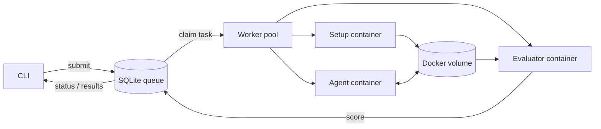

# Agentic Harness

A CLI for running coding agents against benchmarks in Docker. It handles task setup, agent execution, grading, and result storage. Runs are queued in SQLite and processed by separate workers, so submitting a benchmark does not block on the model.

The repo includes the two supplied benchmarks (`bash-operations`, 5 tasks; `python-tasks`, 3 tasks) and two agents: `mini-swe-agent` (also `agents/mini-swe-agent`, as in the assignment example) and a small, separate agent built on the OpenAI Responses API.

## Setup

Requires Python 3.11+, [uv](https://docs.astral.sh/uv/), and a running [Docker Desktop](https://docs.docker.com/desktop/) installation.

```bash
uv sync --frozen
uv run harness doctor
make images
```

`make images` builds an evaluator image and Python/Alpine runtime images for each agent. The images install `mini-swe-agent==1.17.0` from pinned dependencies; no Git submodule is needed. The two Responses agent images reuse the mini images as a base but run different agent code.

Set the API credentials in the **worker's terminal**. The CLI does not automatically read `.env` files.

```bash
export OPENAI_API_KEY='your-api-key'
export MSWEA_MODEL_NAME='openai/gpt-5-mini'  # for mini-swe-agent
# Optional: export OPENAI_RESPONSES_MODEL='gpt-5.4-mini'
```

Keep real credentials out of Git and shell history. You can use your shell's secure input mechanism instead of typing a key directly into an `export` command. See `.env.example` for variable names.

## Run a benchmark

**Terminal 1: submit work.** The command prints a run ID and exits.

```bash
uv run harness run --agent mini-swe-agent --benchmark bash-operations
uv run harness run --agent mini-swe-agent --benchmark python-tasks --task_ids py-001,py-002
uv run harness run --agent openai-responses --benchmark bash-operations
```

**Terminal 2: start a worker.** The worker takes queued tasks, runs up to two concurrently, and stays alive until interrupted.

```bash
uv run harness worker --concurrency 2
```

**Inspect runs** from either terminal:

```bash
uv run harness list --active
uv run harness status --run_id RUN_ID
uv run harness results --run_id RUN_ID --format table
uv run harness results --run_id RUN_ID --format json
```

To run one task synchronously for a demo:

```bash
uv run harness run --agent mini-swe-agent --benchmark bash-operations --task_ids bash-001 --wait
```

Run `uv run harness --help` for options. `--timeout` (default: 600 seconds *per phase*), `--cpus` (default: 1), and `--memory` (default: 2g) set container limits. `--data-dir` is a top-level option; both worker and CLI must use the same directory (default: `.harness`). `worker --drain` runs queued tasks and exits. Each worker enforces its own concurrency limit; this is not a cluster-wide scheduler.

## Architecture



The implementation has four main parts:

- `adapters.py` reads benchmark and agent configs. It normalizes task IDs, prompts, setup/evaluation commands, and grading results.
- `runtime.py` launches isolated setup, agent, and grading containers. They share a task-specific Docker volume, not a container process.
- `store.py` holds runs, task states, scores, and errors in SQLite. Atomic task claims prevent two workers from taking the same queued task.
- `worker.py` runs tasks concurrently, updates heartbeats, and records results or execution errors. `cli.py` handles submission and queries.

The benchmarks intentionally have different interfaces. Bash's evaluator may exit 1 for a wrong answer; Python's always exits 0 and reports the outcome in JSON. Their `harness.json` files describe these differences so the worker doesn't need benchmark-specific code.

At submission, the harness snapshots the benchmark source and agent configuration. Each task then follows **setup → agent → evaluate**. Setup and grading mount the benchmark snapshot read-only, without network access. Only the agent container receives allowed API environment variables and network access. Agent containers cannot mount the benchmark source or Docker socket through this harness. The evaluator's Python tests run in a clean directory so the agent cannot pass by editing tests in its workspace.

Results and errors are stored in `.harness/harness.db`; per-phase logs live under `.harness/runs/`. Resources are cleaned up after normal completion or timeouts. A worker that disappears leaves a job in `running` until another worker expires its lease and marks it as an error. The system does **not** silently retry paid LLM calls.

## Add a benchmark

Create a directory with a dataset, setup/evaluation scripts, and `harness.json`. For example:

```json
{
  "dataset": "dataset.json",
  "id_field": "id",
  "prompt_field": "prompt",
  "setup": ["python", "{benchmark}/prepare.py", "{task_id}", "--workspace", "{workspace}"],
  "evaluate": ["python", "{benchmark}/grade.py", "{task_id}", "--workspace", "{workspace}"],
  "evaluation_exit_codes": [0],
  "evaluator_image": "agentic-harness-evaluator:1"
}
```

Each dataset entry needs an ID, a prompt, and a `docker_image`. Grading must print JSON with `task_id`, boolean `passed`, and numeric `score` from 0 to 1. Point `--benchmark` at the directory. The shipped adapter handles command-driven benchmarks; more complex benchmarks would need an additional adapter implementing the `Benchmark` protocol.

## Add an agent

Build the agent into an image and write a config:

```json
{
  "image": "my-agent:1",
  "command": ["my-agent", "--prompt", "{prompt}", "--workspace", "{workspace}"],
  "env": ["MY_AGENT_API_KEY"]
}
```

Then run with `--agent /path/to/agent.json`. Use an `images` mapping instead of `image` when tasks need different runtimes. The built-in `mini-swe-agent` adapter checks for a submitted trajectory rather than trusting the CLI exit code alone.

The optional `openai-responses` agent is in `docker/openai_responses_agent.py`. It runs a bounded function-calling loop: the model requests shell commands, the agent executes them inside its task container, and their output is sent back to the model. Limits are 12 tool rounds, 30 seconds per command, and 12 KB of command output. Its default model is `gpt-5.4-mini` and can be changed with `OPENAI_RESPONSES_MODEL`.

## Tests and validation

```bash
make test         # unit and local integration tests, no Docker or API key
make smoke        # Docker lifecycle with a deterministic fixture agent
make mini-smoke   # real mini CLI with simulated model responses; no API cost
```

The original validation records report 25 passing local tests, two Docker fixture cases, and two real-mini Docker cases. A regression test for the assignment-style agent path was added during review, bringing the current local suite to 26 passing tests. Each Docker pair covers both benchmarks, including all eight tasks. Live runs are also recorded as 8/8 for `mini-swe-agent` with GPT-5 Mini and 8/8 for `openai-responses` with GPT-5.4 Mini. These are results on the eight supplied tasks, not a general model-quality claim. Evidence: [`docs/validation.md`](docs/validation.md), [`LIVE_RESULTS.json`](LIVE_RESULTS.json), and [`RESPONSES_LIVE_RESULTS.json`](RESPONSES_LIVE_RESULTS.json).

## Limits

This is a single-machine harness, not a multi-tenant production service. SQLite isn't intended as a shared queue across hosts. Image tags are not pinned to digests, so image rebuilds can change the environment. There is no cancellation, global concurrency limit, automatic job retry, container/disk quota, or crash-recovery cleanup process. Raw logs can contain sensitive diagnostics; don't commit `.harness` or agent trajectories. Stronger isolation for untrusted workloads would include non-root users, restricted agent egress, and separate execution hosts.
